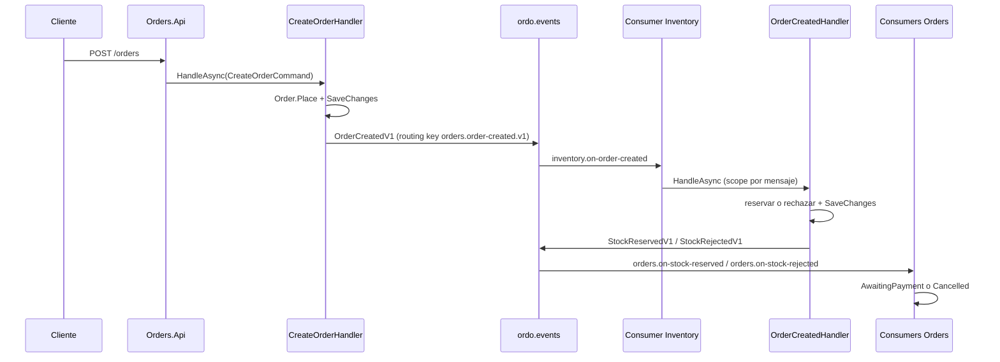

# Mapa de Ordo: cómo navegar la solución y por qué está así

Esta guía explica los **16 proyectos** de `Ordo.slnx`, qué responsabilidad tiene cada uno y **por qué** existe con esos límites. Está pensada para abrirla junto al repositorio: empieza por la ruta rápida, baja al mapa de proyectos y, cuando quieras entender una decisión, salta a la tabla de "Decisiones y su porqué" o a la ADR correspondiente. Los identificadores, rutas y eventos se dejan en inglés para que coincidan con el código.

> **Regla de oro:** `AGENTS.md` manda. `docs/` es la fuente detallada. Las ADRs explican *por qué*; no se reescriben, se suplementan con una nueva.

## Ruta rápida

1. Lee `AGENTS.md` (reglas no negociables) y `docs/roadmap.md` (fase actual y criterios de "hecho").
2. Abre `Ordo.slnx`: 16 proyectos en `src/BuildingBlocks`, `src/Contracts`, `src/Orders`, `src/Inventory` y `tests`.
3. Elige un caso de uso y síguelo en [Sigue un mensaje de punta a punta](#sigue-un-mensaje-de-punta-a-punta).
4. Para entender cualquier límite, busca la fila en [Decisiones y su porqué](#decisiones-y-su-porqué).
5. Verifica siempre con los cuatro comandos de [Comandos](#comandos-y-siguiente-paso).

## Modelo mental en tres ideas

| Idea | Cómo se ve en el código | Por qué |
|---|---|---|
| **EDA + hexagonal por servicio** | Orders e Inventory tienen cada uno Domain → Application → Infrastructure → Api. No se referencian entre sí. | Los servicios solo comparten eventos; así un cambio en uno no rompe el otro y la consistencia es eventual (`docs/architecture.md`). |
| **El broker queda detrás de puertos** | Application solo conoce `IIntegrationEventPublisher` y `IIntegrationEventHandler<TEvent>`. RabbitMQ vive en `BuildingBlocks.Messaging.RabbitMq`. | La Fase 6 quiere sustituir RabbitMQ por Kafka **sin tocar Domain ni Application** (ADR 0002). |
| **CQRS sin librería mediadora** | `ICommandHandler<T,TResult>` / `IQueryHandler<T,TResult>` se inyectan y se llaman directamente desde endpoints y consumers. | Adapters ya son el despachador; un mediator es una dependencia innecesaria y MediatR tiene riesgo de licencia (ADR 0005). |

```
Ordo.slnx  (16 proyectos)
├── src/
│   ├── BuildingBlocks/  Messaging.Abstractions · Messaging.RabbitMq
│   ├── Contracts/       Ordo.Contracts
│   ├── Orders/          Domain · Application · Infrastructure · Api
│   └── Inventory/       Domain · Application · Infrastructure · Api
└── tests/               ArchitectureTests · Orders.Tests · Inventory.Tests
                         Messaging.Abstractions.Tests · Messaging.RabbitMq.Tests
```

## Mapa de proyectos

Abreviaturas de referencias: **D** = `Domain` propio, **A** = `Application` propio, **C** = `Ordo.Contracts`, **MA** = `Messaging.Abstractions`, **MR** = `Messaging.RabbitMq`, **Infra** = `Infrastructure` propio.

| Proyecto | Capa | Refs | Responsabilidad | Por qué existe / regla clave |
|---|---|---|---|---|
| `Ordo.Contracts` | Contracts | — | Eventos de integración inmutables (`OrderCreatedV1`, `StockReservedV1`, `StockRejectedV1`). | Único código compartido entre servicios. Nunca contiene dominio ni .NET type names en el wire. |
| `Messaging.Abstractions` | BuildingBlocks | C | Puertos (`IIntegrationEventPublisher`, `IIntegrationEventHandler<T>`, `IBrokerPublisher`), envelope y reglas JSON. | Solo técnico y broker-agnóstico; si aparece dominio aquí, se detiene el trabajo (ADR 0002, 0006). |
| `Messaging.RabbitMq` | BuildingBlocks | MA | Adaptador RabbitMQ 7.x async: conexión, topología, confirms, consumer con ack manual. | Aísla exchanges, routing keys, quorum queues y prefetch fuera de Application. Es el único `TODO(phase-2)`: DLQ. |
| `Orders.Domain` | Domain | — | `Order`, `OrderLine`, `Money`, `OrderStatus`, eventos de dominio. | BCL únicamente. Las transiciones inválidas se rechazan **dentro del agregado**, no en la API. |
| `Orders.Application` | Application | D, C, MA | `CreateOrderHandler`, `GetOrderHandler`, consumers de stock, `Result`/`Error`, mapper a `OrderCreatedV1`. | Define puertos y orquesta casos de uso; sin EF, sin RabbitMQ, sin ASP.NET. |
| `Orders.Infrastructure` | Infrastructure | A, D, C, MA | `OrdersDbContext`, repositorios, UoW y la migración `InitialCreate`. | Implementa los puertos; es el único lugar que sabe Npgsql/EF Core. Base de datos propia. |
| `Orders.Api` | Api | A, Infra, C, MA, MR | Composition root: `/orders`, `/health/*`, dos consumers de stock, DI de handlers. | Traduce HTTP → comandos y `Result` → `ProblemDetails`. Sin lógica de negocio ni `DbContext` directo. |
| `Inventory.Domain` | Domain | — | `StockItem`, `Reservation`, `ReservationLine`, estados y eventos de dominio. | Mismo aislamiento que Orders. `StockItem.Version` prepara el control de concurrencia con `xmin`. |
| `Inventory.Application` | Application | D, C, MA | `OrderCreatedHandler` (reservar/rechazar), `SetStockHandler` (admin dev), puertos, mapper. | Idempotente por decisión persistada por `OrderId`; el Inbox real llega en Fase 2. |
| `Inventory.Infrastructure` | Infrastructure | A, D, C, MA | `InventoryDbContext`, repositorios, UoW, migración con `xmin`, traducción de conflictos. | Convierte `DbUpdateConcurrencyException` en `SaveOutcome.ConcurrencyConflict` para que Application reintente. |
| `Inventory.Api` | Api | A, Infra, C, MA, MR | Consumer de `orders.order-created.v1`, `PUT /inventory/stock/{productId}`, health checks. | Endpoint de siembra **solo para desarrollo, sin autenticación en Fase 1**. |
| `ArchitectureTests` | Tests | los 10 proyectos de `src/` | 8 tests: matriz de referencias, reglas de capas, nombres de eventos, presencia de README. | Hacen cumplir las reglas automáticamente. Si fallan, se arregla el código, nunca el test. |
| `Orders.Tests` | Tests | D, A, C, MA | Tests del agregado y de handlers, con dobles en memoria y `TimeProvider` fijo. | Dominio se prueba sin infraestructura; comprueba el orden guardar → publicar. |
| `Inventory.Tests` | Tests | D, A, C, MA | Tests de stock, reservas, idempotencia por duplicado y reintentos por concurrencia. | Cubre el riesgo central de Inventory: dos órdenes compitiendo por la última unidad. |
| `Messaging.Abstractions.Tests` | Tests | C, MA | 5 tests: metadatos fuera del JSON body, wire type, partition key, camelCase, enums como string. | Evita que ADR 0006 se rompa sin querer (los metadatos van en headers). |
| `Messaging.RabbitMq.Tests` | Tests | C, MA, MR | 6 tests de integración con Testcontainers contra un broker real. | Verifica confirms, persistencia, headers, ack/nack, cold start y routing. Necesita Docker. |

**Cómo leer las referencias:** la matriz exacta está en `docs/architecture.md` y se valida en `tests/Ordo.ArchitectureTests/ProjectReferenceMatrixTests.cs`. Regla corta: Domain no referencia nada; Application solo D + C + MA; Infrastructure implementa los puertos; Api compone. Ningún servicio referencia a otro.

## Los bloques compartidos (sin dominio)

### `src/Contracts/Ordo.Contracts`

- `IIntegrationEvent.cs` — `EventId`, `OccurredAtUtc`, `EventType`, `PartitionKey` (ADR 0006).
- `Orders/OrderCreatedV1.cs`, `Inventory/StockReservedV1.cs`, `StockRejectedV1.cs` — contratos versionados.
- **Por qué:** los cuatro campos de metadatos son `[JsonIgnore]`; van en headers AMQP, no en el body. `EventType` también es la routing key. Un cambio rompiente exige un `V2`, nunca editar `V1`.

### `src/BuildingBlocks/Ordo.BuildingBlocks.Messaging.Abstractions`

- `IIntegrationEventPublisher.cs` — publicar desde Application (Fase 1 directo / Fase 2 outbox, sin cambiar la interfaz).
- `IIntegrationEventHandler.cs` — manejador de entrada tipado, sin reflexión.
- `IntegrationEventEnvelope.cs`, `OutboundMessage.cs`, `MessagingJson.cs` — envelope y serialización única.
- **Por qué:** puertos pequeños a propósito. "Resiste la tentación de construir un bus genérico" (`docs/messaging.md`).

### `src/BuildingBlocks/Ordo.BuildingBlocks.Messaging.RabbitMq`

- `RabbitMqConnection.cs` / `RabbitMqTopology.cs` — una conexión larga, canales por operación; exchange `ordo.events` y colas quorum duraderas.
- `RabbitMqBrokerPublisher.cs` — mensajes persistentes, `mandatory`, confirms.
- `DirectIntegrationEventPublisher.cs` — publicación inmediata tras el commit (Fase 1).
- `ConsumerSubscription.cs` / `RabbitMqConsumerHost.cs` — dispatch a `IIntegrationEventHandler<T>` abriendo un `IServiceScope` por mensaje; ack manual y prefetch configurable.
- **Por qué:** todo lo específico de RabbitMQ se queda aquí para que Kafka pueda sustituirlo. Los fallos permanentes hacen nack sin requeue; los transitorios hacen requeue (DLQ pendiente para Fase 2).

## Servicio Orders — de la petición HTTP al evento

| Archivo clave | Qué hace | Por qué |
|---|---|---|
| `Orders.Api/Program.cs` | Registra DI, OpenAPI, ProblemDetails, health y los dos consumers. | Composition root: aquí se decide qué implementación concreta se usa. |
| `Orders.Application/CreateOrderHandler.cs` | Valida, crea el agregado, guarda y publica `OrderCreatedV1`. | Guarda antes de publicar; la ventana entre ambas acciones es el **dual-write** documentado que se corrige con outbox en Fase 2. |
| `Orders.Domain/Order.cs` | Máquina de estados (Pending → AwaitingPayment → Confirmed / Cancelled). |Los eventos de dominio se lanzan aquí, nunca se serializan directamente. |
| `Orders.Application/OrderEventsMapper.cs` | Traduce `OrderPlaced` → `OrderCreatedV1`. | El dominio no conoce contratos públicos; el mapeo es explícito y versionable. |
| `Orders.Application/StockReservedHandler.cs` / `StockRejectedHandler.cs` | Reaccionan al stock → `AwaitingPayment` o `Cancelled`. | Idempotentes: si el evento llega dos veces, el estado ya es el esperado y no hay nuevo efecto. |
| `Orders.Infrastructure/Persistence/OrderConfiguration.cs` | Mapea `orders`, `Money` como `ComplexProperty` y `order_lines` con PK `(OrderId, ProductId)`. | Evita columnas shadow nulas y líneas duplicadas por producto. |
| `Orders.Infrastructure/Persistence/Migrations/` | `InitialCreate` + snapshot de EF. | Esquema versionado; se aplica explícitamente con `dotnet ef database update`. |

## Servicio Inventory — de la reserva al resultado

| Archivo clave | Qué hace | Por qué |
|---|---|---|
| `Inventory.Api/Program.cs` | Consumer de `orders.order-created.v1` en la cola `inventory.on-order-created` + endpoint dev de stock. | Un solo servicio declara su propia cola; el exchange lo declara el adaptador. |
| `Inventory.Application/OrderCreatedHandler.cs` | Si ya existe reserva por `OrderId`, no hace nada. Si no, lee stock, reserva o rechaza, guarda y publica el resultado. | Idempotencia natural en Fase 1: la decisión queda persistida. Reintenta hasta 3 veces ante conflicto de versión. |
| `Inventory.Domain/StockItem.cs` | `CanReserve`, `Reserve`, `SetQuantity` y `uint Version`. | `uint + IsRowVersion()` se mapea a la columna de sistema `xmin` de PostgreSQL; no crea una columna falsa. |
| `Inventory.Domain/Reservation.cs` | `Reserve` / `Reject` con validación y eventos de dominio. | Un registro por orden: es la clave de idempotencia y de auditoría de la decisión. |
| `Inventory.Infrastructure/Persistence/EfCoreUnitOfWork.cs` | Traduce `DbUpdateConcurrencyException` a `SaveOutcome` y limpia el change tracker. | Application no debe conocer excepciones de EF; decide reintentar con lectura fresca. |
| `Inventory.Infrastructure/Persistence/ReservationConfiguration.cs` | PK `order_id`, línea propia con shadow FK tipada. | Refuerza "una decisión por orden" y evita ambigüedad de claves en `OwnsMany`. |

## Sigue un mensaje de punta a punta

Este es el recorrido real del happy path (verificado en vivo con Postgres + RabbitMQ):



Paso a paso con archivos:

1. `POST /orders` llega a `src/Orders/Ordo.Orders.Api/Program.cs` → `ICommandHandler<CreateOrderCommand, Result<OrderDto>>`.
2. `CreateOrderHandler` crea la orden, guarda y publica `OrderCreatedV1` mediante `DirectIntegrationEventPublisher`.
3. El adaptador pone `type`, `message_id`, `occurred_on_utc`, `partition_key` (= `OrderId`) en headers y publica en `ordo.events` con confirms.
4. `Inventory.Api` consume de `inventory.on-order-created`; `ConsumerSubscription.For<OrderCreatedV1>` abre un scope y llama al handler.
5. `OrderCreatedHandler` decide: con stock → `Reservation.Reserve` + `StockReservedV1`; sin stock → `Reservation.Reject` + `StockRejectedV1`.
6. Orders consume ambos eventos y mueve la orden a `AwaitingPayment` o `Cancelled`. Con stock suficiente, el estado observado tras los eventos es **`AwaitingPayment`**; el pago llega en Fase 3.
7. Verificación manual: `GET /orders/{id}`, tabla `stock_items` (cantidad decrementada) y tabla `reservations` (`Reserved` o `Rejected`).

> Si Orders publica antes de que Inventory arranque, aparece `312 NO_ROUTE`. En E2E hay que levantar **ambos hosts** antes del primer POST.

## Decisiones y su porqué

| Decisión | Razón documentada | Dónde se aplica / verifica |
|---|---|---|
| Un monorepo, un `.slnx` | Hace explícitas las reglas de dependencia y permite refactors atómicos. | ADR 0001 · `Ordo.slnx` · `ProjectReferenceMatrixTests`. |
| Dominio sin paquetes ni referencias | La duplicación pequeña entre servicios es intencional: evita dominio compartido. | `docs/architecture.md` · test de aislamiento. |
| Application sin EF/RabbitMQ/ASP.NET | Los puertos viven en Application; Infrastructure los implementa. | Matriz de referencias. |
| Sin MediatR; handlers directos + decorators | Evita riesgo de licencia y mantiene el pipeline explicable. El registro es manual (Scrutor requiere aprobación). | ADR 0005 · comentario en los `Program.cs`. Los decoradores aún **no** están implementados como clases. |
| `SaveChangesAsync` explícito en handlers | Mantiene visible la atomicidad con el futuro outbox. | Handlers de Orders e Inventory. |
| Metadatos en headers, `[JsonIgnore]` en el body | Sin reflexión ni registro que pueda desincronizarse; nunca .NET type names en el wire. | ADR 0006 · `EventMetadataTests`. |
| `EventType` = tipo de envelope + routing key | Un solo valor para contrato y enrutamiento; `PartitionKey` se conserva para Kafka. | `RabbitMqEnvelopeHeaders`, `RabbitMqTopology`. |
| RabbitMQ.Client 7.x async (`IChannel`) | La API `IModel` es legacy. | Adaptador RabbitMQ. |
| Mensajes persistentes + confirms + quorum + ack manual | At-least-once; el consumidor decide cuándo confirma. | `RabbitMqBrokerPublisher`, `RabbitMqConsumerHost`. |
| Colas de reintento hacen dead-letter al **default exchange** | Si se hiciera a `ordo.events`, todos los suscriptores volverían a recibir el mensaje. | `docs/messaging.md` · DLQ aún `TODO(phase-2)`. |
| Concurrencia optimista con `xmin` en `StockItem` | Conflicto en consumer es **transitorio** (reintento), no un fallo de negocio. | `StockItemConfiguration`, `EfCoreUnitOfWork`, tests de Inventory. |
| Publicación directa en Fase 1 | Dual-write asumido y documentado; no se "arregla" antes de tiempo. | `CreateOrderHandler`, README de Orders.Application. |
| Inbox/Outbox hechos a mano en Fase 2 | Son centrales para los objetivos de aprendizaje; los frameworks esconden la mecánica. | ADR 0003 (aún `Proposed`). |
| API devuelve orden `Pending`/`AwaitingPayment`, no espera al saga | La consistencia entre servicios es eventual y la API lo refleja. | `docs/architecture.md`. |
| README por proyecto y tests de arquitectura desde el inicio | Cada proyecto nace documentado; los tests fallan si falta README o aparece una referencia prohibida. | `ProjectReadmePresenceTests`. |

## ADRs de un vistazo

| ADR | Estado | Decisión en una línea |
|---|---|---|
| [0001](adr/0001-monorepo-with-single-slnx.md) | Proposed | Monorepo con un solo `Ordo.slnx`. |
| [0002](adr/0002-eda-with-broker-behind-ports.md) | Proposed | EDA con el broker detrás de puertos; RabbitMQ primero, Kafka después. |
| [0003](adr/0003-hand-built-outbox-and-inbox.md) | Proposed | Outbox e inbox hechos a mano (Fase 2). |
| [0004](adr/0004-dotnet-10-lts-as-initial-target.md) | **Accepted** | `net10.0`, SDK 10.0.203; no migrar a .NET 11 sin nueva ADR. |
| [0005](adr/0005-cqrs-with-explicit-handlers-and-decorators.md) | **Accepted** | CQRS con handlers explícitos y decorators; sin mediator. |
| [0006](adr/0006-integration-event-metadata-members.md) | **Accepted** | `EventType` y `PartitionKey` son miembros de `IIntegrationEvent`, pero no se serializan. |

## Estado real y pendientes intencionales

- La Fase 1 está implementada hasta el slice 5 (Inventory); **no hay checkbox marcado** en `docs/roadmap.md`: se marcan solo cuando el humano lo confirma.
- Faltan los tests E2E (slice 6): `Testcontainers.PostgreSql` y `Microsoft.AspNetCore.Mvc.Testing` aún no están en `Directory.Packages.props`.
- No existe Inbox ni Outbox; el único `TODO(phase-2)` en producción es la DLQ en `RabbitMqConsumerHost.cs`.
- Los decorators de ADR 0005 están diseñados pero **no hay clases decorator** todavía.
- `PUT /inventory/stock/{productId}` no tiene autenticación: usar solo en local.
- ADRs 0001–0003 siguen en `Proposed` aunque sus decisiones ya estén aplicadas.

## Inconsistencias que te vas a encontrar

Reportadas para que no te sorprendan; no las resolví aquí porque el alcance era solo documentar:

1. `README.md` dice "`AGENTS.md` §0 gana en conflicto", pero `AGENTS.md` empieza en §1 (la precedencia está en el preámbulo).
2. La tabla de READMEs del root omite `Ordo.BuildingBlocks.Messaging.RabbitMq` (sí existe y tiene README).
3. `AGENTS.md` §5 solo lista `Ordo.ArchitectureTests` bajo `tests/`, pero hay cinco proyectos de tests.
4. `messaging.md` y `roadmap.md` presentan la ADR 0006 como pendiente; ya está `Accepted`.
5. `AGENTS.md` prohíbe `async void` sin excepciones; `docs/conventions.md` permite "event handlers where unavoidable". Gana `AGENTS.md`.
6. Los READMEs de las APIs anuncian tests E2E que aún no existen.
7. Los tests de RabbitMQ usan estado mutable estático y `Task.Delay` en polling acotado, aunque las convenciones lo desaconsejan.

## Checklist para orientarte

- [ ] Sé por qué Domain no puede referenciar `Ordo.Contracts`.
- [ ] Puedo nombrar los tres puertos de `Messaging.Abstractions` y decir cuál usa cada capa.
- [ ] Puedo seguir `OrderCreatedV1` desde `POST /orders` hasta la tabla `reservations`.
- [ ] Entiendo por qué el retry por concurrencia es transitorio y no un rechazo.
- [ ] Sé qué está pendiente de Fase 2 y por qué no se implementó antes.

## Comandos y siguiente paso

```bash
dotnet restore Ordo.slnx
dotnet build Ordo.slnx -c Release --no-restore
dotnet test Ordo.slnx -c Release --no-build
dotnet format Ordo.slnx --verify-no-changes

docker compose -f deploy/docker-compose.yml up -d --wait
```

Siguiente lectura: `docs/roadmap.md` para la Fase 1 (E2E) y `docs/messaging.md` §§5–6 para outbox/inbox.
